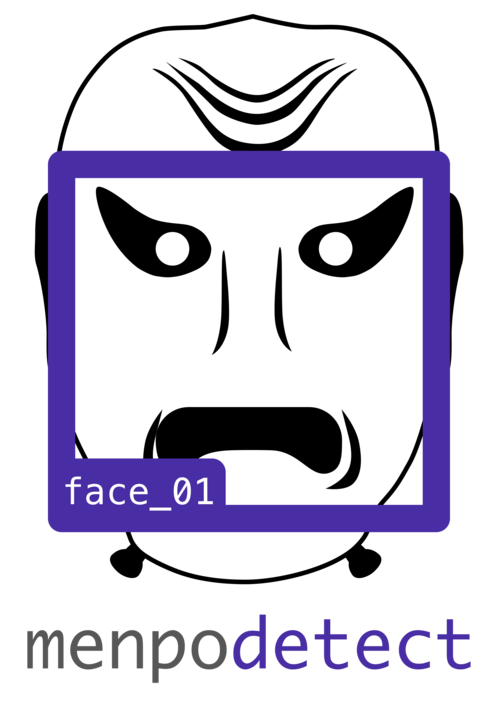

<p align="center">
  </center>
  <br><br>
  <a href="https://pypi.python.org/pypi/menpodetect"></a>
  <a href="https://github.com/menpo/menpodetect/blob/master/LICENSE.txt"></a>
  <br>
  <a href="https://github.com/menpo/menpodetect/actions/workflows/ci.yml"></a>
</p>


menpodetect - Simple object detection
=====================================
Simple object detection within the [Menpo Project](http://www.menpo.org/). We do not attempt
to implement novel techniques, but instead wrap existing projects so that they
integrate nicely with Menpo. At the moment the current libraries are wrapped:

  - **[dlib](http://dlib.net/) (Boost Software License - Version 1.0)**  
    Frontal face detection, arbitrary dlib models and training code is all
    wrapped.
  - **[opencv](http://opencv.org/) (BSD)**
    Frontal face detection, profile face detection, eye detection and arbitrary
    OpenCV cascade files (via loading from disk) are all provided.

Important
---------
This project aims to wrap existing object detection libraries for easy
integration with Menpo. The core project is under a BSD license, but since
other projects are wrapped, they may not be compatible with this BSD license.
Therefore, we urge caution be taken when interacting with this library for
non-academic purposes.

Installation
------------
```
pip install menpodetect                 # the core, and the Menpo dependencies
pip install "menpodetect[opencv]"       # + OpenCV face and eye detectors (OpenCV 4)
pip install "menpodetect[dlib]"         # + dlib face detector and training (builds dlib from source: needs cmake)
```
or, from conda-forge (where dlib and OpenCV are prebuilt):
```
conda install -c conda-forge menpodetect dlib opencv
```

Releases
--------
Releases are built and published to PyPI from GitHub Actions by pushing a signed `vX.Y.Z` tag (PyPI
trusted publishing, no tokens); the version number comes from the tag.

Documentation
-------------
See our documentation on [ReadTheDocs](http://menpodetect.readthedocs.org)
